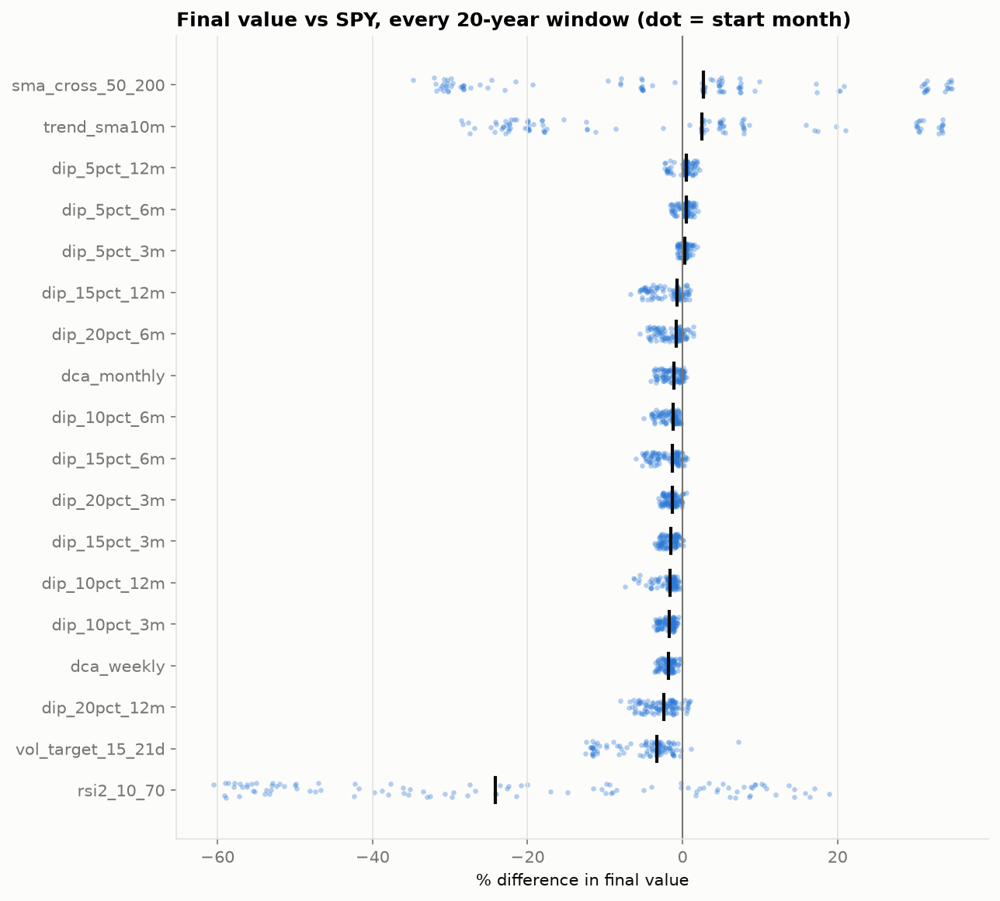
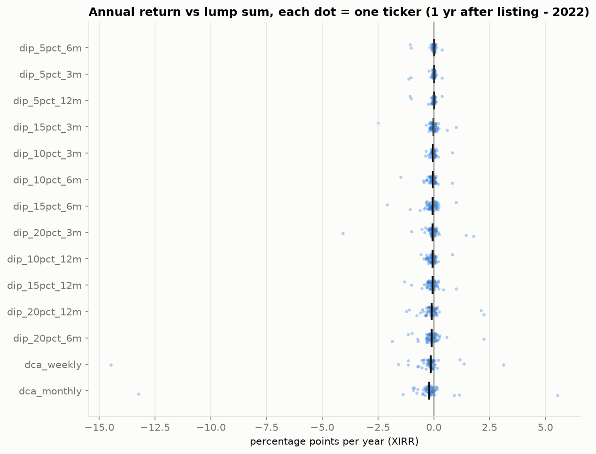
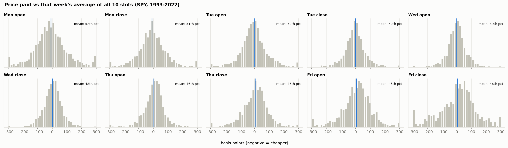
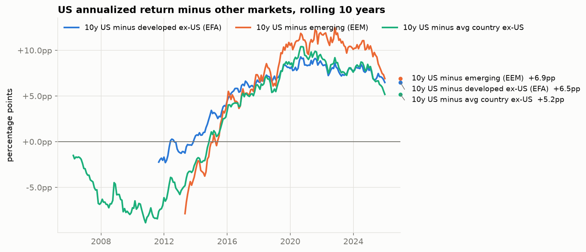

# Results

**Hypothetical.** A Roth IRA receiving $5,000 on the first trading day of each year, long-only, after
spreads, SEC/FINRA fees and money-market drag. "SPY" means buying SPY with each deposit and holding (B1),
on the same deposits and window as the strategy. The development period runs through 2022; the
2023–2025 lockbox is reported separately at the end. Full tables: `outputs/report_tables.md`.

## Bottom line

**Nothing reliably beat buying SPY with each deposit and holding it.** After costs, no strategy's
advantage in ending value was statistically significant once we account for the number of strategies
tried (Holm-adjusted bootstrap p = 1.0 for every strategy). The equal-weight benchmark is the only
exception, and it is driven by hindsight in the stock list. The trade-offs that do hold up:

- **Investing a deposit immediately beats spreading it out or waiting for a dip.** The cost is small (about
  0.1–0.2 points a year) but consistent, across start dates, tickers and 95 years of market history.
- **Trend-following (10-month average, 50/200-day cross) cut the worst drawdown from −55% to −21%/−34%,
  but ended with less money.** That held in 1994–2022 and much more strongly in 1927–2022.
- **More active trading did worse.** RSI(2), dual momentum and the machine-learning swing model all
  trailed SPY, mainly from time out of the market, with costs adding to it.

## Main results, 1994–2022 (SPY strategies)

| Strategy | Ending value vs SPY | XIRR (SPY 8.9%) | Sharpe (SPY 0.45) | Worst drawdown (SPY −55%) | 95% CI, ending value vs SPY | DSR vs SPY |
|---|---|---|---|---|---|---|
| Monthly DCA | −3.3% | 8.7% | 0.44 | −54% | −17% to +3% | 0.00 |
| Weekly DCA | −3.0% | 8.7% | 0.44 | −55% | −15% to +3% | 0.01 |
| Buy the dip, best of 12 (5%, 3-month wait) | −0.2% | 8.9% | 0.45 | −55% | −7% to +9% | 0.13 |
| Buy the dip, other 11 settings | −1.0% to −3.8% | 8.7–8.8% | 0.44–0.45 | −55% | | ≤ 0.11 |
| Trend: 10-month average | −9.3% | 8.4% | **0.59** | **−21%** | −61% to +168% | 0.10 |
| 50/200-day cross | −6.8% | 8.5% | **0.57** | **−34%** | −59% to +174% | 0.11 |
| Volatility target 15% | −13.8% | 8.1% | 0.51 | −43% | −52% to +42% | 0.02 |
| RSI(2) mean reversion | −40.6% | 6.1% | 0.50 | −28% | −79% to +119% | 0.03 |
| Sector rotation, top 3 (from 2000) | +1.4% | 9.1% (9.0%) | 0.40 (0.33) | −47% | −31% to +102% | 0.41 |
| Dual momentum (from Sept 2003) | −37.9% | 5.9% (9.9%) | 0.46 (0.48) | −26% | −68% to +68% | 0.05 |
| ML swing model, best of 12 (from 1997) | +5.6% | 8.9% (8.6%) | 0.40 (0.41) | −49% | −45% to +50% | 0.05 |
| ML swing model, other 11 settings | −52% to +1% | 3.9–8.6% | 0.18–0.42 | −36% to −49% | | ≤ 0.04 |
| 60/40 SPY/IEF (from 2002) | −27.2% | 7.4% (9.9%) | 0.62 (0.50) | −32% | −53% to +27% | 0.00 |
| Equal weight, 64 assets* | +108% | 12.7% | 0.73 | −46% | +84% to +260% | 0.98 |

The CI is a paired block bootstrap (21-day blocks, 1,000 resamples) of the ending-value ratio.
**DSR** (deflated Sharpe ratio) is the probability that the strategy's daily return in excess of SPY
has a positive Sharpe, after adjusting for the number of variants tried in its family. A value of 0.95
or more would be convincing; nothing except the biased equal-weight benchmark gets close. Figures in
parentheses are SPY over that strategy's own window.

\*Equal weight holds today's Dow members (NVDA, AAPL, …), which were chosen with hindsight. That is
survivorship bias, not skill.

**Against random timing.** Trend and the 50/200-day cross beat 96–98% of random in/out schedules with
the same time in market on Sharpe ratio, and 74–83% on ending value. Their timing is better than chance.
Their deficit against SPY comes from spending about 25% of the time out of the market, mostly during
recoveries. RSI(2) also beats random timing (98th percentile), but it is in the market only 17% of the
time, so it still ends far behind SPY.

**Costs.** At 0×, 1× and 2× the default spreads, only RSI(2) changes meaningfully (XIRR 6.6% → 6.1% →
5.5%). Everything else moves by 0.1 points a year or less.

## Does the start date matter? (fresh portfolios started every month)

| Strategy | 10-year windows beating SPY | 20-year windows beating SPY | Median vs SPY (20 yr) |
|---|---|---|---|
| Monthly DCA | 24% | 12% | −1.1% |
| Weekly DCA | 8% | 0% | −1.8% |
| Buy the dip 5% (3/6/12-month wait) | 56–65% | 77–84% | +0.3% to +0.5% |
| Buy the dip 10–20% | 4–33% | 0–15% | −0.7% to −2.4% |
| Trend: 10-month average | 61% | 55% | +2.5% |
| 50/200-day cross | 62% | 55% | +2.7% |
| Volatility target | 33% | 2% | −3.4% |
| RSI(2) | 51% | 30% | −24.1% |

The windows overlap heavily: every 20-year window from 1994 to 2022 contains 2000–02 or 2008, often
both. Trend-following's apparent edge here is those two crashes counted many times over.

## Long history: US market 1927–2022 (Ken French data)

| Strategy | Ending value vs lump sum | Sharpe | Worst drawdown | 20-year windows beating lump sum |
|---|---|---|---|---|
| Lump sum | — | 0.43 | −84% | — |
| Monthly DCA | −2.4% | 0.43 | −80% | 8% |
| Buy the dip 10% (6-month wait) | −1.7% | 0.42 | −84% | 5% |
| Trend: 10-month average | **−50%** | 0.52 | −55% | 33% |
| 50/200-day cross | −64% | 0.46 | −63% | 24% |
| Volatility target | −36% | 0.51 | −66% | 17% |
| RSI(2) | −98% | 0.15 | −65% | 11% |

Over 95 years, trend-following kept its main benefit: it limited the 1929–32 crash to −11% a year,
against −42% for buy-and-hold. It also kept a better Sharpe ratio. But it lost half the ending value,
and it trailed buy-and-hold in two-thirds of 20-year periods.

## By market regime (annualized, 1993–2022)

| | 1993–99 | 2000–02 | 2003–07 | 2008–09 | 2010–19 | 2020–22 |
|---|---|---|---|---|---|---|
| SPY | 23.1% | −14.5% | 12.6% | −10.7% | 13.4% | 7.6% |
| Monthly DCA | 20.8% | −13.8% | 12.4% | −10.4% | 13.3% | 7.6% |
| Trend: 10-month average | 18.8% | **+0.4%** | 11.1% | **+11.4%** | 6.5% | 7.3% |
| 50/200-day cross | 18.8% | +0.9% | 10.2% | +11.0% | 8.3% | 3.4% |
| Volatility target | 18.5% | −13.9% | 11.7% | −2.7% | 11.7% | 6.1% |

Trend-following wins in crashes and gives it back in steady bull markets, such as 2010–19 (6.5% vs 13.4%).

## Across tickers (deploying deposits into each of 64 assets)

Monthly DCA trailed lump sum for 89% of stocks and 75% of ETFs, by a median of 0.23 and 0.07 points a
year. Buy-the-dip was close to a coin flip against lump sum, with medians within ±0.1 points a year.
Single-stock results are illustrative only (hindsight-chosen list).

## Follow-up: does the weekday or time of a weekly DCA purchase matter?

Weekly DCA of $96 into SPY, bought every week at one of 10 slots (Monday–Friday × open 9:30 / close
16:00 ET; a holiday moves the purchase to the next session). Run with `scripts/day_of_week.py`. This was
added after the lockbox, so 2023–2025 is descriptive only.

| Slot | Ending value 1993–2022 | vs best | Avg price vs that week's 10-slot average |
|---|---|---|---|
| Mon open | $704,273 | — | −8.8 bps (95% CI −14.8 to −2.8) |
| Mon close | $704,188 | −0.01% | −9.0 bps |
| Tue open / close | $703,774 / $703,709 | −0.07% / −0.08% | −2.3 / −2.5 bps |
| Wed open / close | $703,527 / $703,330 | −0.11% / −0.13% | +0.3 / +2.3 bps |
| Thu open / close | $703,142 / $703,280 | −0.16% / −0.14% | +3.1 / +4.2 bps |
| Fri open / close | $703,221 / $703,263 | −0.15% / −0.14% | +7.1 / +5.6 bps |

The best slot beat the worst by about $1,100 on $704,000 over 30 years, roughly 0.005% a year. Average
prices rise steadily from Monday to Friday by about 16 bps. That is SPY's normal upward drift over four
sessions, so Monday "wins" only because the money is invested a few days sooner, which is the same reason
lump sum beats DCA. Single weeks are noise (±1–2% either way), and Monday open was the cheapest slot in
only 21% of weeks. Open and close on the same day are within about 2 bps. 2023–2025 showed the same
ordering, with a $76 gap. **Practical rule: buy when the money arrives, at whatever slot is convenient.**
Pre-market and intraday times were not testable (daily open and close data only).

## Follow-up: swing-trading assets that mean-revert

The idea: find assets whose big moves tend to reverse, then buy their dips and sell the rebounds.
`scripts/mean_reversion.py` does this in three pre-declared steps, with selection and design kept
apart from the test period. Full output: `outputs/mean_reversion/report.md`.

1. **Selection (1993–2007).** We measured the 10-day variance ratio for every asset with at least 5 years
   of data (a ratio below 1 means moves tend to reverse) and picked the 5 most mean-reverting:
   **XOM, CVX, WMT, JNJ, SPY** (VR 0.65–0.78). Four of them stay significant after a Holm adjustment
   across 54 tests. Bond ETFs, gold and high-volatility tech stocks did not mean-revert.
2. **Rule design (1993–2007).** We chose the best of 8 band rules by median Sharpe: buy when the price is
   2 standard deviations below its 50-day average, sell when it returns to the average.
3. **Frozen test (2008–2022).**

| Asset | Swing strategy | Buy and hold same asset | SPY | Worst drawdown, swing vs hold | Time in market |
|---|---|---|---|---|---|
| WMT | $130k (6.6%/yr) | $179k (10.3%) | $195k (11.2%) | −16% vs −36% | 21% |
| JNJ | $134k (7.0%) | $192k (11.1%) | $195k | −28% vs −35% | 18% |
| CVX | $108k (4.4%) | $189k (10.9%) | $195k | −52% vs −56% | 24% |
| XOM | $87k (1.8%) | $152k (8.4%) | $195k | −53% vs −63% | 28% |
| SPY | $89k (2.1%) | $195k (11.2%) | $195k | −39% vs −53% | 18% |

**Every pick lost to holding the same asset, and to SPY, at 1×, 2× and 5× costs.** The mean reversion
itself mostly held up out of sample: all five still had VR below 1 in 2008–2022, and for 4 of 5, buying
after a deep dip was followed by an above-average month (JNJ +3.5% against +0.8% normally). The strategy
lost anyway because it was in the market only about 20% of the time. It captured the post-dip bounces but
missed the ordinary upward drift on the other days, and over 15 years that drift was worth more. To profit
from mean reversion you need to short the highs or lever up at the lows, and a long-only Roth can do
neither. Even on the 1993–2007 selection period the rule beat holding on return for only one of the five
(WMT).

## Follow-up: always-invested sector reversal

This keeps the dip-buying idea but drops the cash drag. Each month it holds the 3 sector ETFs with the
**worst** recent return, so it is always fully invested. The settings were fixed up front with no tuning,
run over 2000–2022 (`scripts/sector_reversal.py`, `outputs/sector_reversal/report.md`).

| Strategy | Ending value | XIRR | Sharpe | Beats random sector picks (value) |
|---|---|---|---|---|
| Worst 3 sectors, 1-month lookback | $287k | 7.0% | 0.29 | 31% |
| Worst 3 sectors, 3-month lookback | $252k | 6.1% | 0.25 | 12% |
| Best 3 sectors, 12-1 month momentum | $386k | 9.1% | 0.40 | 78% |
| Equal weight, all sectors | $395k | 9.3% | 0.41 | |
| SPY | $380k | 9.0% | 0.33 | |

Reversal across sectors failed: it did worse than picking sectors at random. Across sectors the effect
runs the other way, as momentum, but even that only tied SPY. Equal-weighting the sectors matched SPY,
and all of its edge came from 2000–2010 (4.1% vs 0.6% a year), when it held less tech during the bust.

## Follow-up: small-cap and value tilts (what to hold, not when)

These use the Ken French value-weighted size × book-to-market portfolios, 1927–2022, with each January
deposit invested immediately (`scripts/factor_tilts.py`, `outputs/factor_tilts/report.md`). Assumed
annual fund costs are deducted: market 0.03%, large-value 0.10%, small-cap 0.15–0.25%.

| Holding | Ending value vs market | XIRR | Worst drawdown | 20-year windows beating market |
|---|---|---|---|---|
| Market | — | 10.5% | −84% | — |
| 70% market + 30% small value | +254% | 12.1% | −85% | 96% (worst −11%) |
| 70% market + 30% large value | +96% | 11.3% | −86% | 92% (worst −14%) |
| Small value | +3,927% | 15.2% | −89% | 96% |
| Large value | +584% | 12.9% | −89% | 89% |
| Small blend (all small-caps) | +931% | 13.4% | −87% | 91% |
| Small growth | −64% | 9.1% | −90% | 33% |
| Large growth | −23% | 10.1% | −83% | 29% |

| Annualized | 1927–63 | 1964–2006 | 1993–2022 | 2007–22 | 2023–25 (descriptive) |
|---|---|---|---|---|---|
| Market | 8.0% | 10.6% | 9.6% | 8.7% | 22.3% |
| Small value | 10.8% | 18.1% | 12.1% | **6.7%** | 11.0% |
| Large value | 9.7% | 14.4% | 10.2% | **6.6%** | 25.0% |
| Small blend | 9.6% | 15.6% | 11.7% | 8.1% | 11.7% |
| Small growth | 7.6% | 8.5% | 6.8% | 7.6% | 13.0% |
| Large growth | 7.9% | 9.7% | 10.1% | **10.6%** | 25.8% |

This is the only result in the study with a large, consistent long-run edge: small value beat the market
in 96% of 20-year windows, by about 4.7 points a year before fees. Three caveats keep it from being a
clear recommendation:
1. **All of the post-publication edge came from 1993–2006.** Small and large value have trailed the
   market since 2007, a stretch of roughly 19 years.
2. **Paper portfolios include hard-to-trade microcaps.** Real small-value funds have tracked them
   imperfectly, so 0.25% is probably an optimistic estimate of the real drag.
3. **A premium can shrink once it is widely known and traded.**

**Small-cap vs. large growth (roughly the S&P 500 Growth).** Over 1927–2022, small-caps as a whole (13.4% a year) beat large growth (10.1%), and small value beat it by about 5 points a year. Small growth was the weakest of the six portfolios (9.1%), so small-caps won only through their value side. Since 2007 the ranking flipped: large growth led every group at 10.6% a year, while small-caps lagged. Leadership has switched for decade-long stretches, so the long-run average says little about the next 10–20 years.

A modest tilt has long-run evidence behind it, but it has also had a long losing streak recently. A
total-market or S&P 500 fund remains the simpler default.

## Follow-up: country momentum and US vs. international

These use 23 US-listed country ETFs (iShares, from CRSP 1996–2025) with SPY standing in for the US.
Strategies are always invested, with settings fixed in advance (`scripts/country_momentum.py`,
`outputs/countries/report.md`). The UK fund changed CRSP PERMNO in 2014 and is chained across the
switch. Against yfinance, total returns agree within 0.2 points a year for most funds, but CRSP is up to
0.5 points a year lower for Italy and France because of early-2000s distributions.

| Strategy | Window | Ending value | XIRR | Worst drawdown | Beats random |
|---|---|---|---|---|---|
| Top 3 countries by 12-1 month momentum | 1997–2022 | $345k | 6.6% (5.9% at 5× costs) | −69% | 85% |
| Equal weight, 23 countries | 1997–2022 | $302k | 5.8% | −63% | |
| SPY | 1997–2022 | $474k | 8.6% | −55% | |
| Hold SPY or EFA, whichever had the higher 12-month return | 2002–2022 | $303k | 8.9% | −57% | 91% |
| 50/50 SPY/EFA | 2002–2022 | $247k | 7.3% | −58% | |
| EFA (developed ex-US) | 2002–2022 | $175k | 4.4% | −61% | |
| SPY | 2002–2022 | $344k | 9.9% | −55% | |

Both signals are real, since each beat 85–91% of random alternatives. Neither beat simply holding the US.
Country leadership changed slowly, and the switching rule moved late each time: it held EFA for 93
months over 9 switches, catching part of international's 2002–07 lead but trailing SPY overall.

**Has the trajectory changed?** The US's rolling 10-year lead over the average other country went from
−8 points a year (2010) to +10.4 (peak, September 2020). Since then it has narrowed: +8.7 at the end of
2022, +8.1 at the end of 2024, and +5.2 at the end of 2025, with the 5-year lead falling from +10.1 to
+4.0 in 2025 alone. The lead is shrinking but still large. The tests above show that reacting to a change
in leadership after it appears has not paid, so this is not a reason to expect VXUS to beat VOO. It is the
usual argument for holding some of both rather than betting on either.

## Strategies that did not beat SPY after costs

On ending value over their full development window: monthly and weekly DCA; all 12 buy-the-dip
settings; 10-month trend; 50/200-day cross; volatility targeting; RSI(2); dual momentum; 10 of 12
ML swing settings; 60/40.

Three came out ahead, none convincingly:
- **Sector rotation:** +1.4%, DSR 0.41.
- **ML swing model, best 2 of 12 settings:** +5.6% and +1.0%. These are the luckiest of 12 tries, with
  DSR ≤ 0.05.
- **Equal weight:** ahead because of survivorship bias.

## Lockbox 2023–2025

This is the pre-registered list (committed in `44b1bc0` before any 2023–2025 result was computed),
evaluated once on 2026-10-16 at 00:25. It is reported unchanged. Three deposits of $5,000 (January 2023,
2024 and 2025), valued at 2025-12-31.

| Strategy | Ending value | vs SPY | XIRR | Sharpe | Worst drawdown | Random-timing percentile (value) |
|---|---|---|---|---|---|---|
| SPY buy-and-hold | $22,554 | — | 21.9% | 1.11 | −19% | |
| ML swing k=21 (best on dev) | $22,231 | −1.4% | 21.1% | 1.09 | −19% | 18th |
| Buy the dip 5%, 3-month wait (best on dev) | $22,097 | −2.0% | 20.7% | 1.07 | −17% | |
| Dual momentum | $21,461 | −4.8% | 19.1% | 0.90 | −19% | 35th |
| Sector rotation | $21,340 | −5.4% | 18.7% | 0.88 | −15% | 76th |
| Monthly DCA | $20,730 | −8.1% | 17.1% | 1.01 | −15% | |
| Volatility target | $20,640 | −8.5% | 16.9% | 1.04 | −16% | 0th |
| Trend: 10-month average | $20,157 | −10.6% | 15.6% | 0.85 | −10% | 3rd |
| RSI(2) | $19,479 | −13.6% | 13.7% | 0.76 | −9% | 98th |
| 60/40 | $19,780 | −12.3% | 14.5% | 0.98 | −11% | |
| 50/200-day cross | $18,996 | −15.8% | 12.3% | 0.70 | −19% | 0th |

**Every strategy trailed SPY in the lockbox.** The two settings chosen as best on 1993–2022 (dip 5% and
swing k=21) came closest, but both still lost, by 2.0% and 1.4%. Trend-following and the 50/200-day cross
did worst relative to random timing (0–3rd percentile). The April 2025 sell-off (−19% to April 8) was a
quick V-shaped recovery. The 50/200-day cross sold after the drop (17 April) and bought back after the
rebound (30 June). The 10-month trend sold just before the worst days (2 April) but stayed out until
3 June, missing the rebound. It had also sat out November 2023, right as a rally began. With only three years and one
short sell-off, none of these differences is statistically significant (Holm p = 1.0), but the
direction agrees with the development results.

## Caveats

- Contributions are hypothetical; real Roth limits were lower.
- SPY stands in for VOO: VOO's fee is about 0.06 points a year lower, the same for every strategy.
- The SPY close on 2000-04-04 in CRSP looks like a bad print. Blocking signals on that day changed
  results by less than 0.02 points a year.
- The Ken French series has no opening prices, so trades there fill at the next close.
- Bootstrap CIs on ending value are very wide for timing strategies. 29 years contain only a few
  crashes, and those decide the outcome.

Charts: `outputs/equity_curves.png`, `drawdowns.png`, `rolling_3y_excess.png`, `random_timing.png`,
`deployment_vs_lump.png`, `rolling_10y_windows.png`, `rolling_20y_windows.png`.
